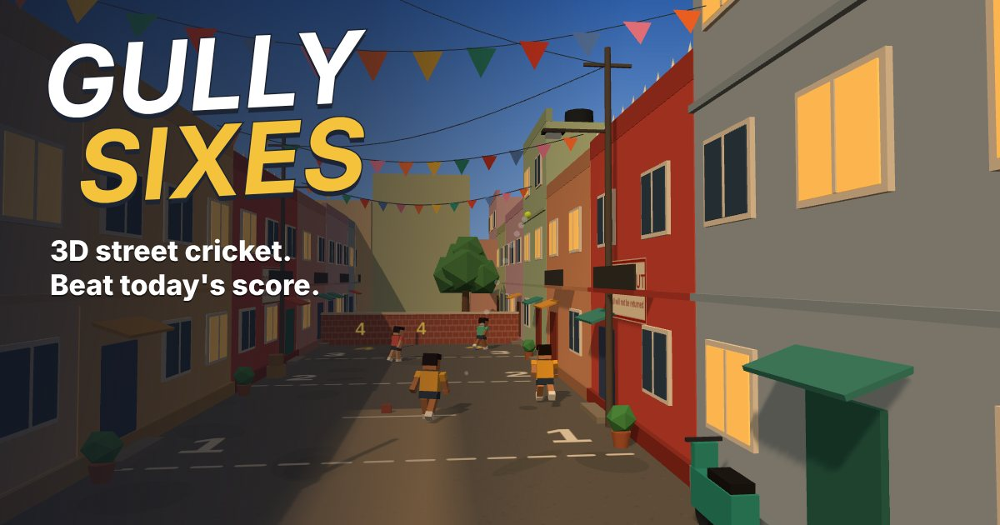
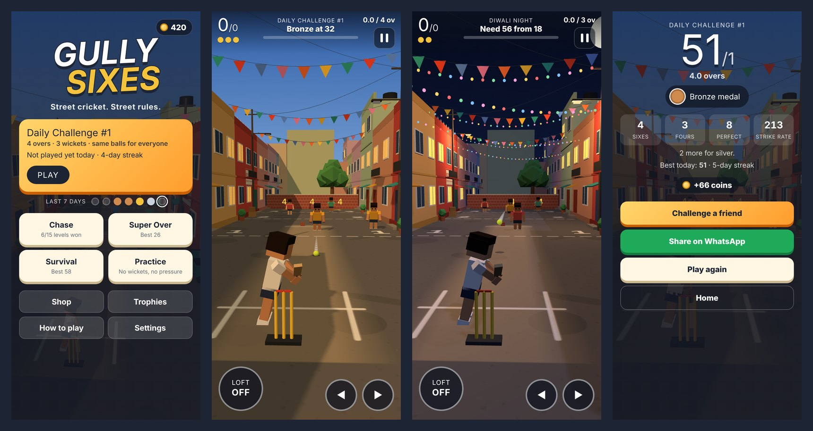

# Gully Sixes

**A 3D street cricket batting game for the browser.**

Bat in a narrow lane under gully rules: clear the far wall for six, break a window and you are out. Built with three.js, with no server and nothing to install.

### [Play Gully Sixes](https://shaurya2093.github.io/gully-cricket/)



## Highlights

- **Daily Challenge.** Four overs and three wickets against the same deliveries for every player that day, with bronze, silver and gold medals, a day streak, and a link that challenges a friend to beat your score.
- **Chase.** Fifteen levels with rising targets, different bowlers and field settings, and up to three stars each.
- **Super Over.** Six balls and two wickets for a quick high score.
- **Survival.** Bat until three wickets fall while the bowling gets harder and the evening turns to night.
- **Practice.** Face any bowler with no wickets at stake.



## Gameplay

| | |
| --- | --- |
| **Gully rules** | Chalk lines score 1, 2 and 3. The far wall is 4 and clearing it is 6. Roofs are 6, except the red houses. A broken window is out, and a fielder can catch you after one bounce. |
| **Extras** | A ball outside the wide lines that is not hit is a wide. A no ball adds a run, cannot take a wicket, and makes the next ball a free hit. |
| **Seven bowlers** | Medium pace, swing, spin, express pace, and two who mix everything, each with their own lengths, speeds and variations. |
| **Stance** | Shuffle across the crease to reach a wide ball or make room. |
| **Timing** | Every shot is graded early, good, perfect or late. Early shots drag to the leg side and late ones squirt to the off side. |
| **Day, dusk and night** | Street lamps, lit windows, a power-cut level, and festival nights with fireworks for sixes. |
| **Progression** | Runs earn coins for bats and balls, and there are 21 achievements to collect. |

## Controls

| Action | Touch | Keyboard |
| --- | --- | --- |
| Swing | Swipe up as the ball arrives | Arrow keys or Space |
| Aim | Swipe left, straight or right | Left, Up and Right arrows |
| Loft | LOFT button | Hold Shift |
| Move across the crease | Arrow buttons | Hold Z or C |
| Pause | Pause button | P or Esc |

Players who prefer tapping to swiping can switch to tap controls in Settings.

## Technology

- **Rendering:** [three.js](https://threejs.org/) on WebGL. The street is merged into a handful of meshes and the players share one material, so a frame takes about 60 draw calls.
- **Adaptive quality:** shadow detail and resolution step down automatically on slow devices.
- **Deterministic simulation:** ball flight, bat contact, walls and fielders run on a fixed time step with seeded randomness, which is what makes the Daily Challenge identical for everyone.
- **No art or audio files:** geometry and textures are generated in code, and all sound is synthesised with the Web Audio API.
- **Installable and offline-capable:** a web app manifest and a service worker let the game be added to a home screen and played without a connection.
- **No tracking:** there are no accounts, ads or analytics. Progress is saved in the player's browser.

## Development

```
npm install        # once
npm run build      # bundles src/ into app.js
npm test           # rules, physics, modes and saved-data tests
npm run calibrate  # plays thousands of simulated matches to check difficulty
npm run serve      # serves the folder at http://localhost:8080
```

`npm run test:browser` plays the whole game in headless Chrome and checks every screen. It needs Python with Playwright and a Chrome binary.

The built `app.js` is committed, so the repository runs as it is: open `index.html` or serve the folder. When shipping a new version, raise `VERSION` in `sw.js` so installed copies refresh their offline files.

### Project layout

| Path | Contents |
| --- | --- |
| `src/config.js` | Street dimensions, timing windows and other tuning values |
| `src/deliveries.js` | Bowlers and how each ball is bowled, including wides and no balls |
| `src/sim.js` | One ball from release to result: bat contact, flight, walls, fielders |
| `src/modes.js` | Game modes, the fifteen levels, field settings and match scoring |
| `src/store.js` | Saved progress, shop items and achievements |
| `src/street.js` | House layout shared by the rules and the 3D scene |
| `src/world.js` | The 3D street, lighting themes and props |
| `src/actors.js` | Batter, bowler and fielders, and their animation |
| `src/game.js` | Match flow, camera, effects and graphics quality |
| `src/ui.js`, `src/input.js`, `src/audio.js` | Screens, controls and sound |
| `tests/`, `tools/` | Tests, build script, difficulty calibration and browser test |

### Tuning the difficulty

Level targets and bowlers are in `LEVELS` and daily medal scores in `DAILY.medals`, both in `src/modes.js`. Timing windows are in `TIMING` in `src/config.js`. After a change, `npm run calibrate` prints scores and win rates for four simulated skill levels, from a beginner to an expert.
